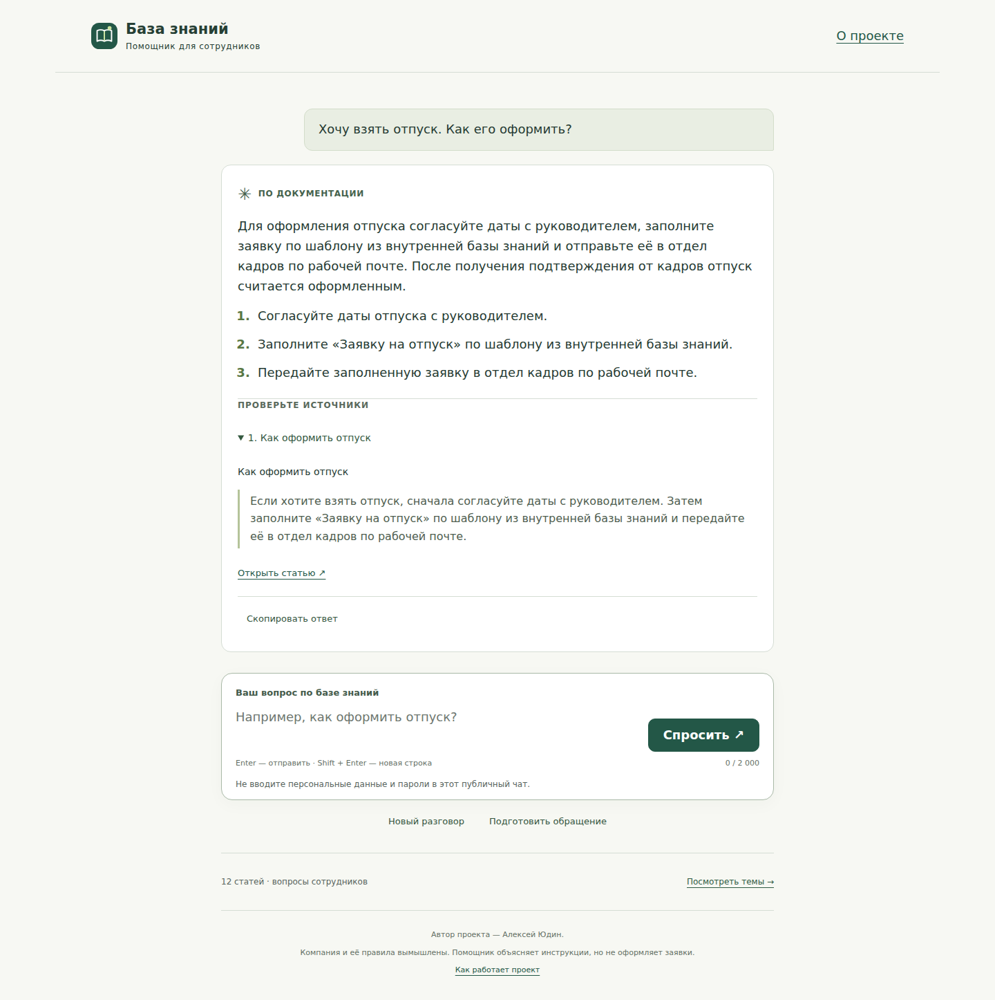

# Knowledge Support Assistant

A browser chat that searches a fictional product knowledge base, answers with source links, and prepares an editable support request draft.

[Demo video](artifacts/demo.webm) · [Russian case study](docs/PORTFOLIO_RU.md) · [GitHub repository](https://github.com/pzzz404/hermes-knowledge-assistant)

The real generation path is FastAPI → SQLite FTS5 → isolated Hermes → answer and evidence-ID validation. There are no embeddings or vector database. The 12 Markdown articles describe the fictional Example Workspace product and are served as read-only `/kb/<slug>` pages.

Run `uv sync --frozen --extra dev`, `uv run python scripts/import_corpus.py`, and `uv run pytest -q`. For a clearly marked technical preview use `ADAPTER=mock uv run uvicorn app.main:app --host 127.0.0.1 --port 8087`. Live answers require a server-side OpenRouter key and a separate Hermes profile; see the [Russian README](README.md) for setup.

This is a working web application that can be deployed and adapted to a product's knowledge base. The included articles and product rules describe the fictional Example Workspace; operational use requires replacing them, configuring a provider key, and evaluating answers on real support questions. The assistant does not integrate with customer workspaces or ticketing systems. Answers may be wrong, so the chat links to the source article. Russian-language questions have not been evaluated, and personal data should not be entered into the public example. Alexey Yudin designed and reviewed this project with coding-agent assistance; no customer deployment or measured business impact is claimed.
