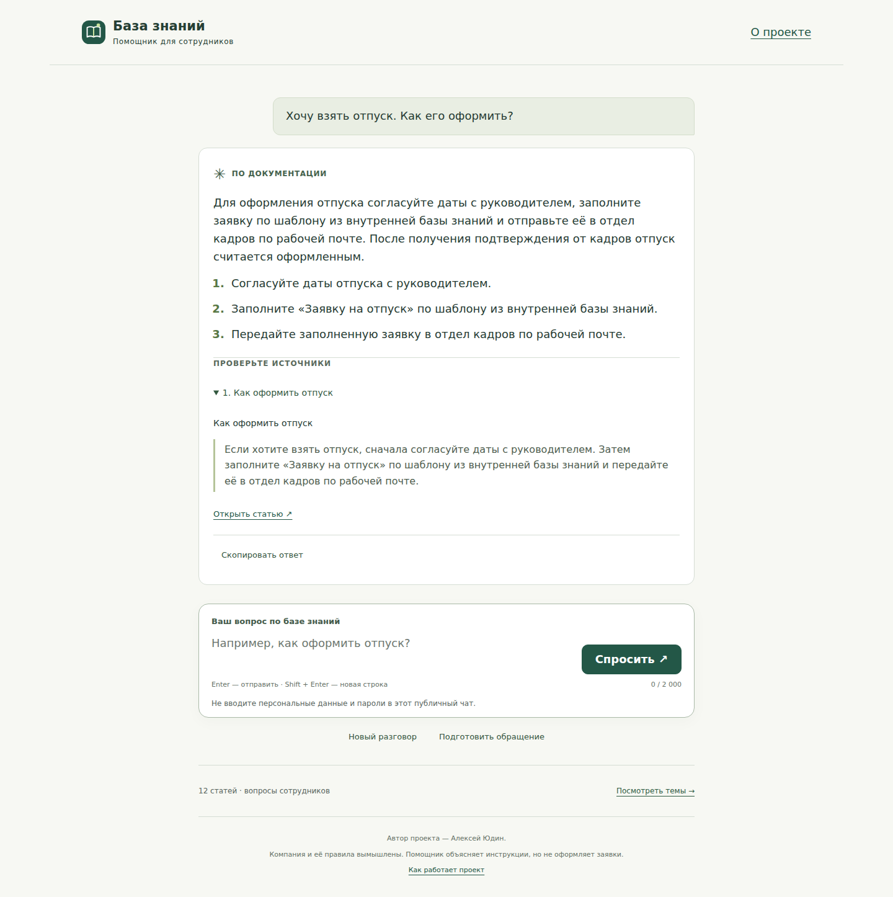

# ИИ-база знаний и чат поддержки с ответами по источникам

**Превратите инструкции в ИИ-чат поддержки:** пользователь задаёт вопрос своими словами,
получает ответ со ссылкой на первоисточник и при необходимости готовит обращение оператору.
Работающая основа для клиентского справочного центра, внутренней базы знаний и онбординга.



[Видео работы на русском](https://pzzz404.github.io/hermes-knowledge-assistant/) · [Страница кейса](docs/PORTFOLIO_RU.md) · [Код на GitHub](https://github.com/pzzz404/hermes-knowledge-assistant) · [English README](README.en.md)

## Где применять

- **Клиентская поддержка и help center:** отвечать на повторяющиеся вопросы по инструкциям и показывать статью, на которой основан ответ.
- **Внутренний help desk:** находить процедуры, правила доступа и настройки без ручного поиска по документам.
- **Онбординг сотрудников и пользователей:** объяснять последовательность действий и уточнять версию интерфейса, если от неё зависит ответ.
- **Помощник оператора поддержки:** быстро находить первоисточник и готовить редактируемый черновик обращения, когда инструкции недостаточно.

Приложение работает с локальным корпусом Markdown-статей. В репозитории приложены 12 оригинальных
статей на русском языке о вымышленном рабочем пространстве «Пример»; для своего продукта замените
корпус и предметные настройки.

Проект показывает RAG без векторной базы: FastAPI → SQLite FTS5 → отдельный Hermes →
проверка структуры ответа и ID найденных фрагментов → собственные страницы `/kb/<slug>`.
Модель не формирует ссылки; их собирает backend из разрешённого корпуса.

## Возможности

- Вопросы своими словами, уточнения в текущем разговоре, новая беседа и восстановление после обновления страницы.
- Ответ с ссылкой и короткой выдержкой из исходной статьи; разные состояния для ответа, уточнения, отсутствия сведений и ошибки сервиса.
- Редактируемый черновик обращения, который можно скопировать. Ничего не отправляется.
- Серверные лимиты запросов и генераций, отдельные сессии и повтор запроса по тому же ID без повторного расхода.

Русскоязычная проверка на 24 вопросах и найденная ошибка с исправлением описаны в [отчёте](docs/EVALUATION.md).

## Запуск

Нужны Python 3.11–3.13 и [uv](https://docs.astral.sh/uv/). Для тестов и технического preview ключ не нужен:

```sh
uv sync --frozen --extra dev
uv run python scripts/import_corpus.py
uv run pytest -q
ADAPTER=mock uv run uvicorn app.main:app --host 127.0.0.1 --port 8087
```

Preview явно помечен `MOCK`: он **не даёт настоящих ИИ-ответов**. Для живого чата нужен ключ OpenRouter на сервере и отдельный Hermes:

```sh
uv run python scripts/bootstrap_hermes.py
uv run python scripts/configure_hermes.py \
  --release .data/hermes-runtime --credential-source /private/path/openrouter.env
.data/hermes-runtime/.venv/bin/python scripts/hermes_server.py
```

В другом терминале:

```sh
uv run uvicorn app.main:app --host 127.0.0.1 --port 8087
```

Файл `/private/path/openrouter.env` содержит `OPENROUTER_API_KEY=...`; ключ не вводится в браузер.
`configure_hermes.py` создаёт отдельный профиль и `.env` в этом проекте, не перезаписывает существующий профиль.
Модель задаётся `--model`, URL Hermes и лимиты — через `.env`. На хосте с обязательным прокси
запускайте Hermes с `HERMES_PROVIDER_PROXY=<proxy URL>`; локальный компьютер может обойтись без него.
Порты `8087` и `8657` — значения по умолчанию; при изменении порта Hermes укажите и `HERMES_URL`.
Чтобы переснять браузерные материалы, установите Chromium через Playwright и ffmpeg, затем
запустите `uv run python scripts/record_demo.py`; для уже установленного браузера
можно задать `PLAYWRIGHT_CHROMIUM_PATH`. Запись выполняет два настоящих запроса к модели.

## Корпус и ограничения

Импорт читает только локальные `content/*.md` с проверенными `slug`, `version` и заголовком.
Нет загрузки файлов посетителями, обхода сайтов, PDF/OCR или внешних действий. Доступны
приглашения, роли, доступ, уведомления, экспорт, архив, общий доступ, журнал, биллинг и
различия интерфейса V1/V2. Цены, внешние гостевые ссылки и API автоматизации намеренно не описаны.

Это работающее веб-приложение, которое можно развернуть и адаптировать под базу знаний своего продукта.
Для применения в работе нужно заменить образцовые статьи и настройки продукта, подключить ключ провайдера
и проверить ответы на своих вопросах. Ответы могут ошибаться, поэтому чат показывает исходные статьи.
В публичный пример не следует вводить персональные данные.

Исходный код и авторские демонстрационные материалы — MIT. Автор: Алексей Юдин.
Сценарий, критерии и проверка определены автором; реализация создана с помощью coding-агентов.
У сторонних библиотек и отдельного Hermes — собственные лицензии; зависимости
не включены в этот репозиторий и устанавливаются по закреплённым версиям.
