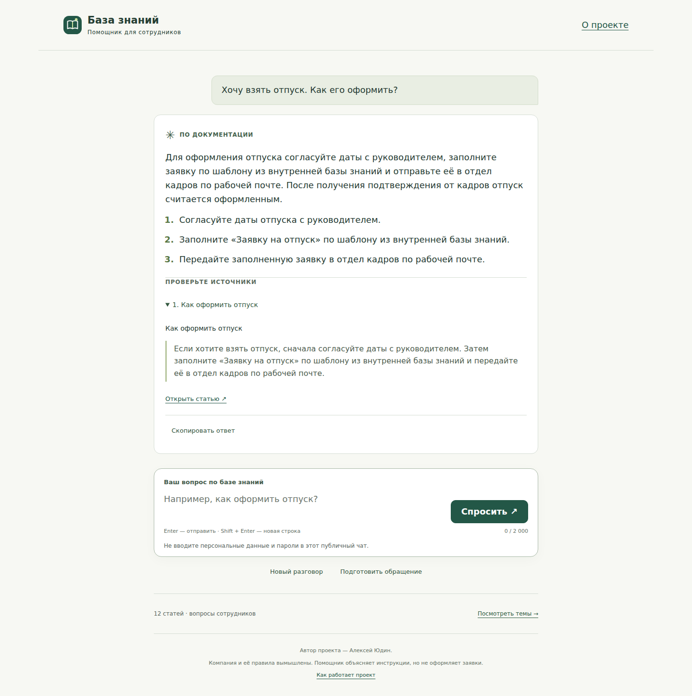

# ИИ-база знаний и чат поддержки с ответами по источникам

**Knowledge Support Assistant · Python · FastAPI · Hermes · SQLite FTS5 · RAG**

[Посмотреть видео](https://pzzz404.github.io/hermes-knowledge-assistant/) · [Как запустить локально](../README.md) · [Код на GitHub](https://github.com/pzzz404/hermes-knowledge-assistant)

Работающее приложение для клиентского справочного центра, внутренней поддержки и онбординга:
ищет инструкцию по вопросу своими словами, отвечает со ссылкой на статью и готовит черновик
обращения, когда документации недостаточно.

## Задача

Новый сотрудник может не знать, где искать правила компании. Коллегам приходится повторять одни и те же объяснения об отпуске, графике и выплатах. Я создал чат, который находит подходящую инструкцию и показывает источник ответа. Если ответа нет, он сообщает об этом и помогает подготовить вопрос ответственному специалисту.

## Сценарий

Новый сотрудник спрашивает: «Хочу взять отпуск. Как его оформить?». Помощник объясняет три шага: согласовать даты с руководителем, заполнить заявку, передать её в отдел кадров. Затем сотрудник спрашивает о денежных штрафах за опоздание. Каждый ответ ведёт к статье, по которой его можно проверить. Страница `/about` объясняет проект внутри самого приложения.

## Устройство

Backend ищет по 12 авторским Markdown-статьям через SQLite FTS5. Найденные фрагменты передаются отдельному Hermes, который формулирует ответ. Backend проверяет JSON, идентификаторы источников, блокирует произвольные ссылки и показывает короткие выдержки из статей. Разговоры хранятся ограниченное время; есть ограничения частоты и дневного числа генераций. Векторной базы и embeddings нет.

## Проверка

Матрица из 24 новых русскоязычных сценариев охватывает 14 отвечаемых вопросов, четыре вне покрытия, три уточнения или продолжения и три запроса о скрытых данных либо действиях. Фактические результаты записаны в [отчёте](EVALUATION.md); исходные ответы сохраняются отдельно от итоговой оценки. Есть локальные тесты границ и проверка браузера.

## Ограничения и авторство

Это работающее веб-приложение, которое можно развернуть и адаптировать под документацию конкретного продукта. Компания вымышлена; 12 оригинальных русскоязычных инструкций распространяются вместе с кодом под MIT. Для применения в работе нужно заменить корпус и предметные настройки, подключить ключ провайдера и проверить ответы на своих вопросах. В текущей версии нет интеграции с рабочими системами, отправки обращений, OCR и автоматического обновления корпуса. Эффект для поддержки требует отдельного измерения; коммерческий результат здесь не заявлен.

Автор — Алексей Юдин. Я сформулировал сценарий и критерии, организовал корпус, архитектуру, интерфейс и проверку. Код подготовлен с помощью coding-агентов; ответственность за решения и результат — моя.
